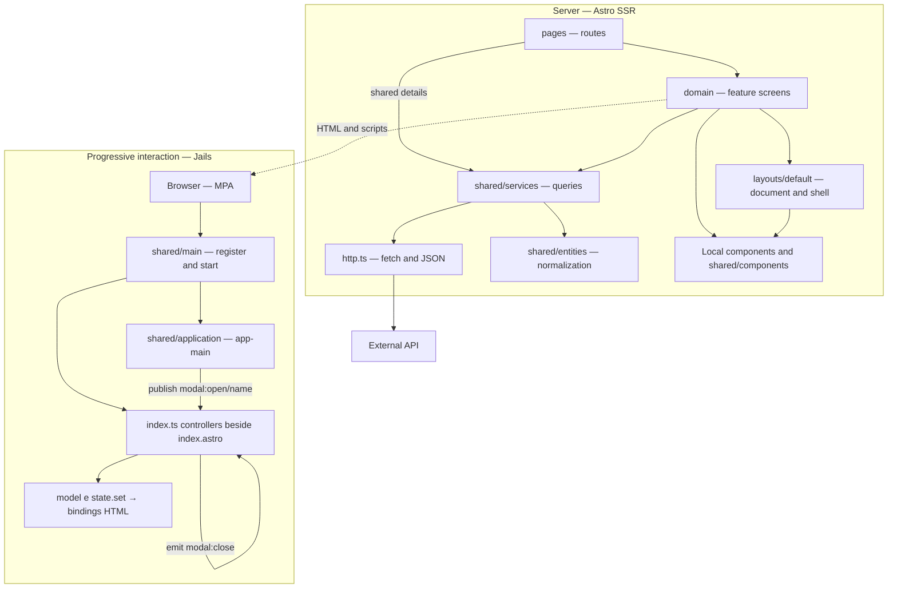
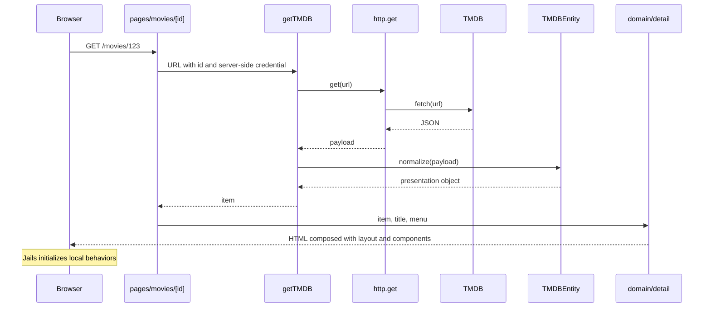

# Architecture diagram

Solid arrows in the first diagram represent dependencies or usage. HTTP queries the provider; the service applies the entity to the response before returning it to the screen. The diagram does not represent nonexistent Clean Architecture layers.

Standalone visual version: [architecture.svg](../assets/architecture.svg).
